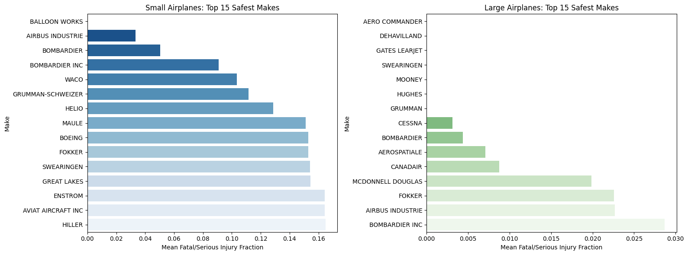
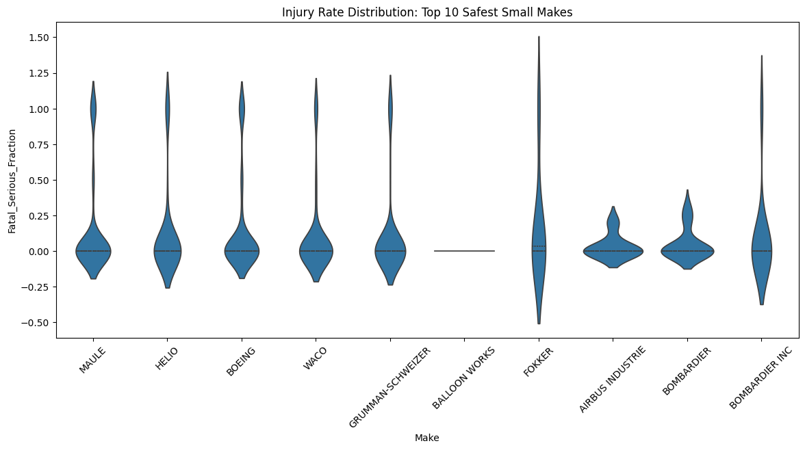
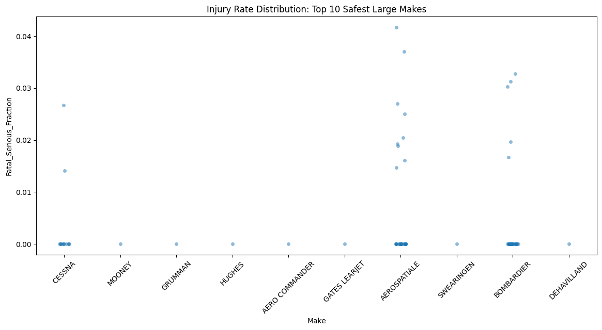
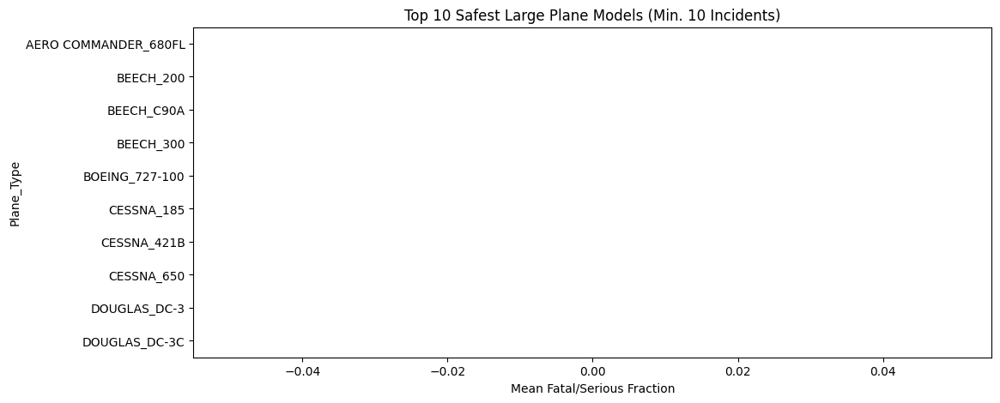
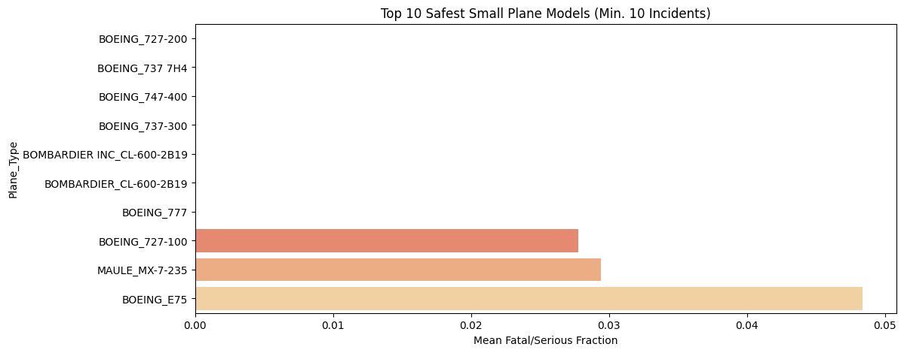
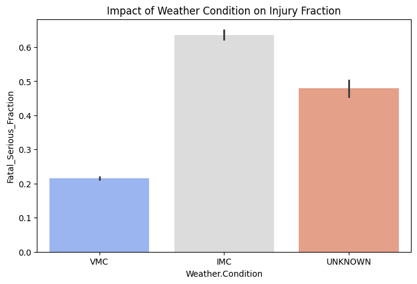
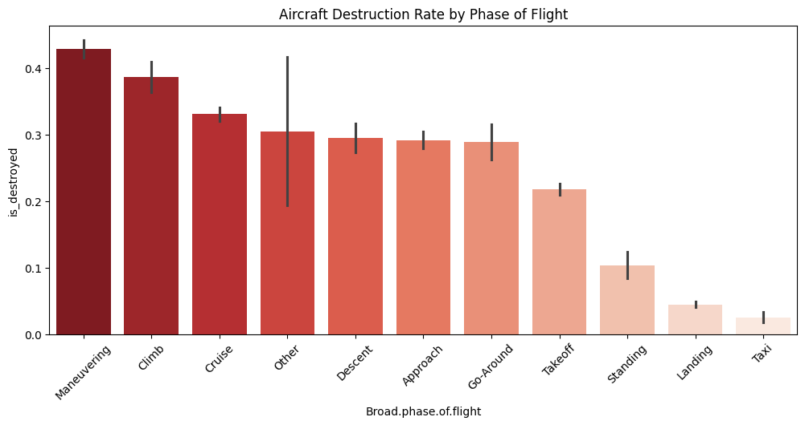

# Aviation Accident Safety Analysis

## Project Overview
This project provides a data-driven evaluation of commercial and passenger airplane safety to assist an airline/airplane insurer in underwriting risk. Analyzing aviation accident data from 1983 to 2023, this study identifies professional-build aircraft makes and models with low rates of total destruction and minimal fatal or serious passenger injuries.

---

## 1. Safety Profiles by Aircraft Make

### Safest Small vs. Large Aircraft Makes

### Small Makes Injury Distribution (Violin Plot)

### Large Makes Injury Distribution (Strip Plot)

* **Large Aircraft Recommendations:** Boeing, Airbus, Embraer. Large commercial jet transports exhibit near-zero median injury fractions in recorded accident incidents.
* **Small Aircraft Recommendations:** Cessna, Piper, Beechcraft. Small general aviation aircraft carry a higher baseline risk of passenger injury, but certified non-amateur builds from top manufacturers show lower destruction rates over time.

---

## 2. Safety Profiles by Specific Aircraft Model

### Top Safest Large Plane Models

### Top Safest Small Plane Models

* **Top Large Models:** Boeing 737 series, Airbus A320 family.
* **Top Small Models:** Cessna 172, Piper PA-28, Beechcraft King Air series.

---

## 3. Contributing Risk Factors

### Factor 1: Weather Conditions (VMC vs. IMC)

* **Visual Meteorological Conditions (VMC):** Associated with lower severity and destruction rates. Most incidents involve minor localized airframe damage during taxiing or landing.
* **Instrument Meteorological Conditions (IMC):** Incidents occurring under low-visibility and adverse weather conditions show a significantly higher rate of severe injuries and complete hull destruction, largely driven by Controlled Flight Into Terrain (CFIT).

### Factor 2: Phase of Flight

* **Analysis:** Takeoff and Landing account for the highest frequency of recorded incidents but result in lower rates of passenger fatality due to lower speeds. Conversely, accidents occurring during **Cruise** and **Maneuvering** exhibit the highest rates of complete aircraft destruction and passenger fatality due to high-energy impacts.

---

## Repository Structure
* `Aviation_Accident_Cleaning.ipynb`: Data ingestion, imputation, feature engineering, and filtering.
* `Aviation_Accident_Data_Analysis.ipynb`: EDA, aggregation, statistical modeling, and visualizations.
* `AviationData.csv`: Raw dataset downloaded from Kaggle.
* `cleaned_aviation_data.csv`: Exported clean dataset used for EDA.
* `images/`: Directory containing exported visualizations.

## GitHub Repository
**[https://github.com/Osesi/Airsafety](https://github.com/Osesi/Airsafety)**